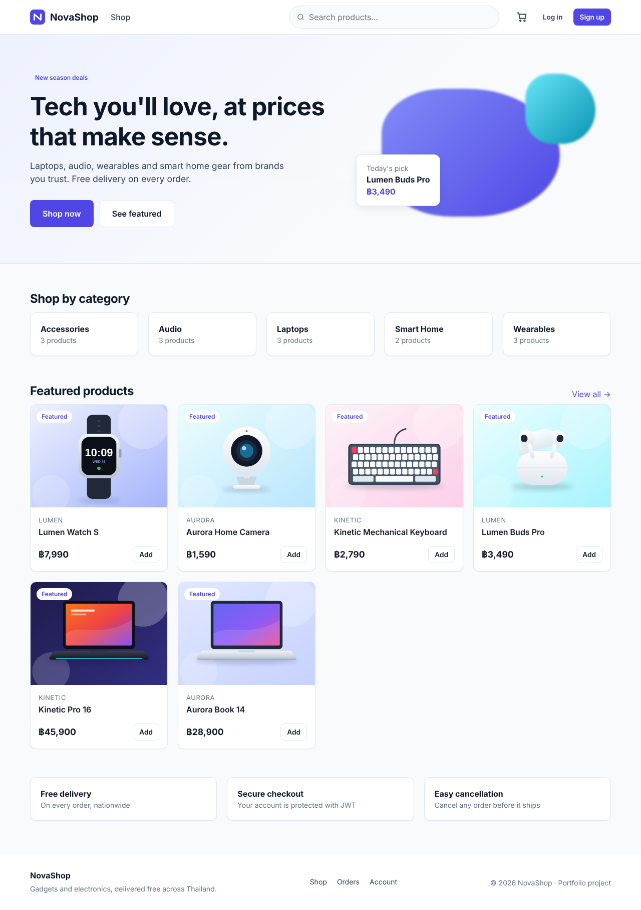
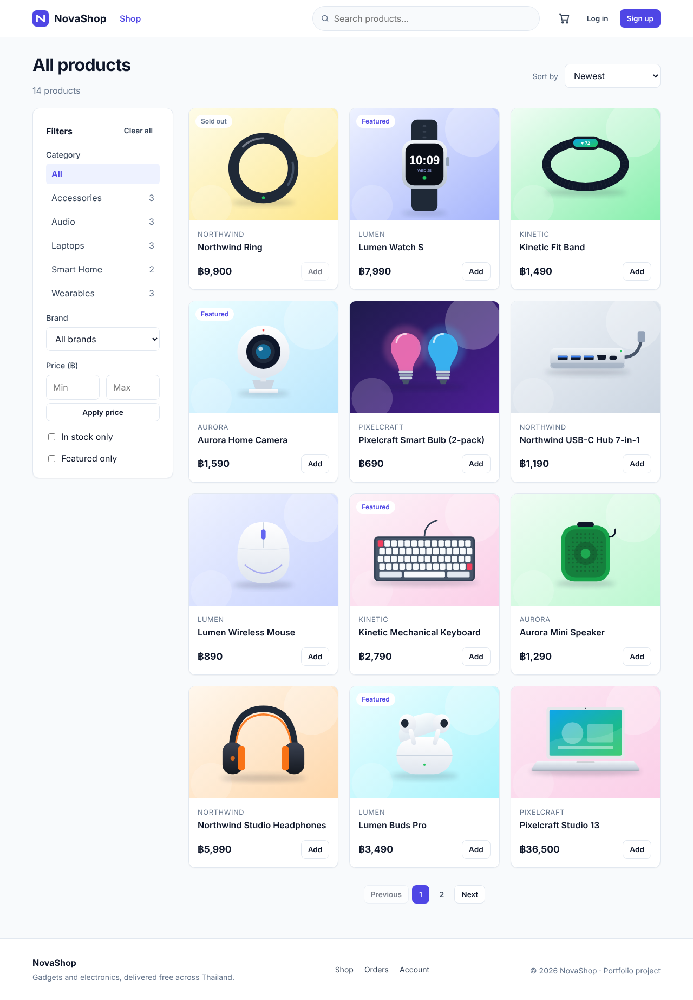
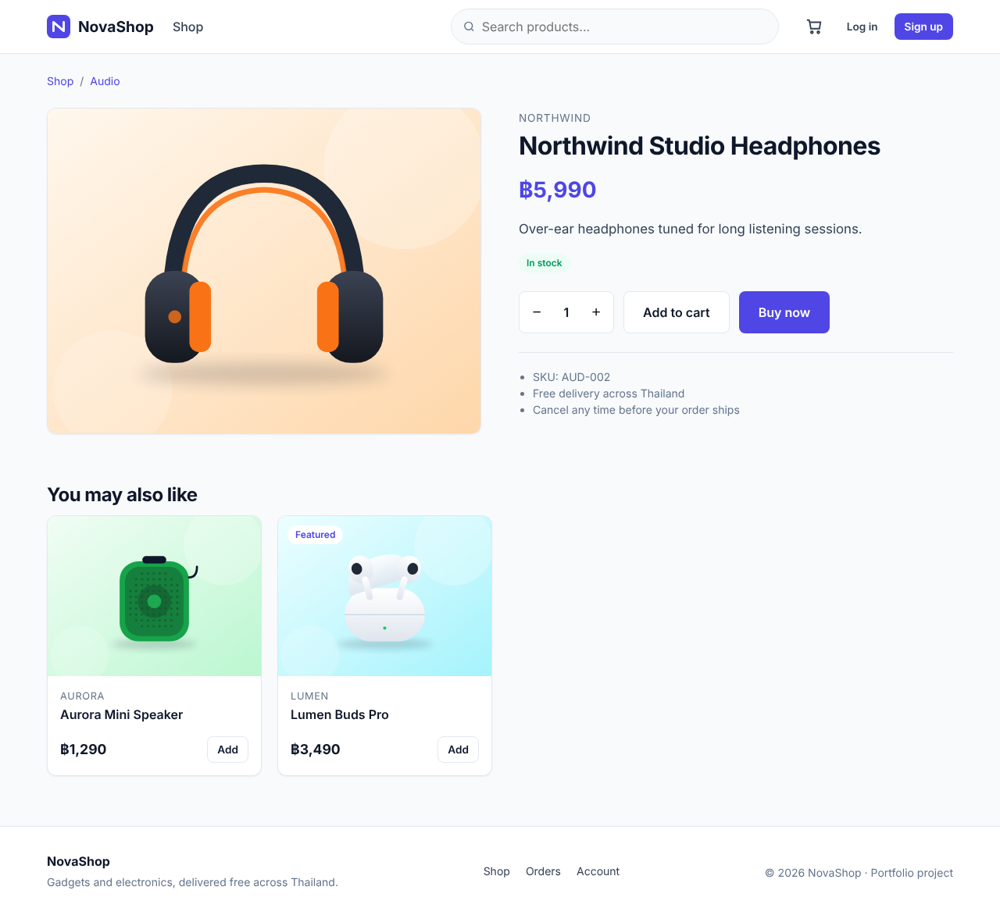
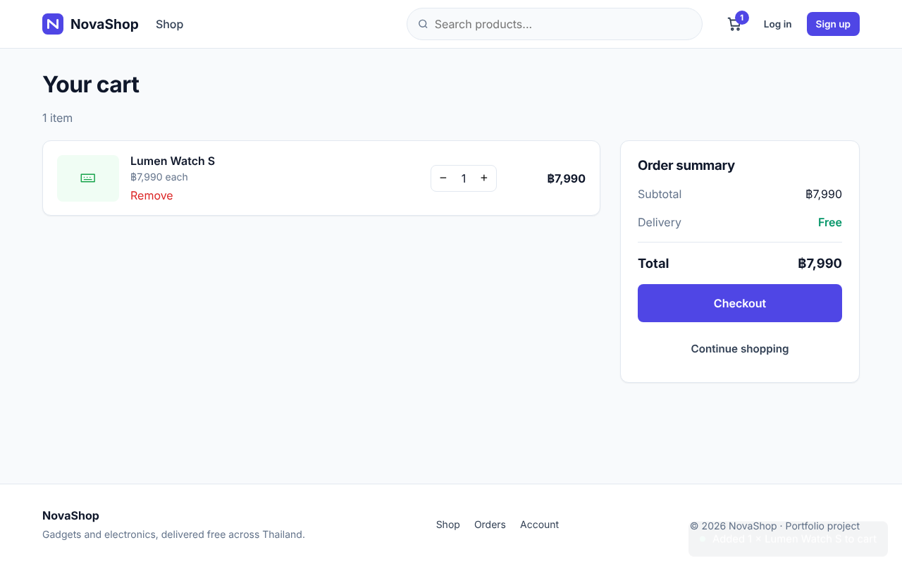
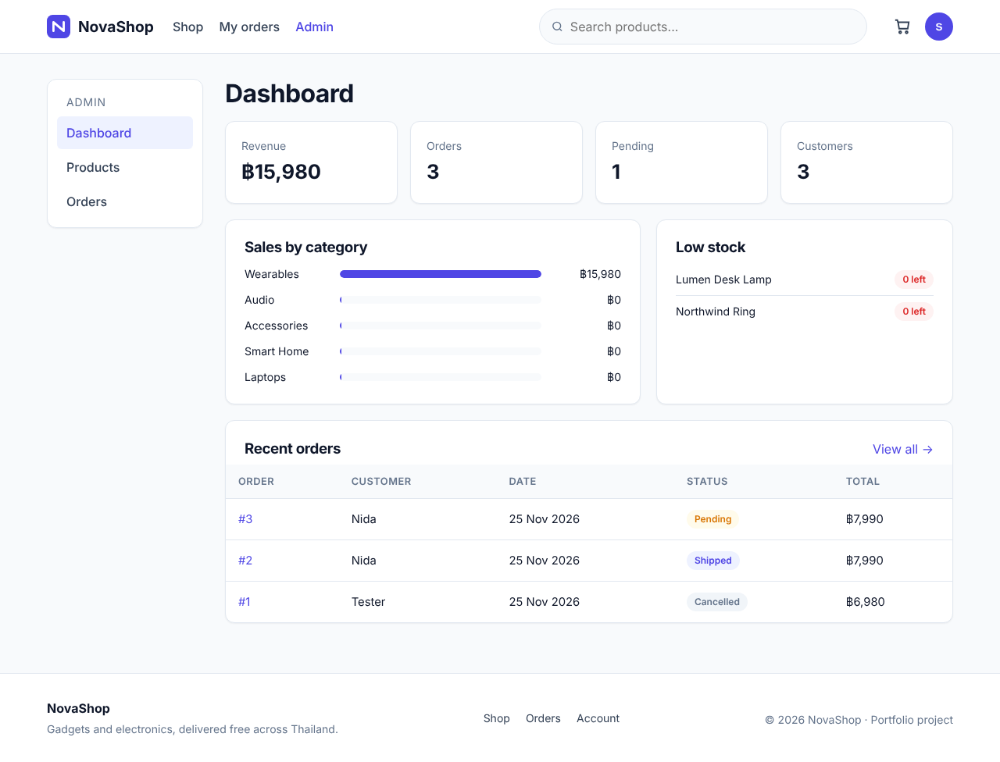

# NovaShop

A full stack e-commerce web app for gadgets and electronics. Customers can browse, search and filter products, add them to a cart, check out and track their orders. Admins get a dashboard with sales numbers, product management and order fulfilment.

**Tech stack:** Vue 3 · Vite · Pinia · Vue Router · Axios · Node.js · Express 5 · PostgreSQL · JWT · bcrypt · Multer · Swagger (OpenAPI)



## Features

**Customers**
- Browse products by category, brand and price, with search, sorting and pagination (filters are kept in the URL so links can be shared)
- Product pages with stock status and related products
- Cart saved in the browser, checkout with delivery details
- Order history, order tracking (pending → paid → shipped → delivered) and cancellation
- Register, log in (JWT), edit name and upload a profile picture

**Admins**
- Dashboard: revenue, order count, customers, sales by category, low-stock alerts
- Create, edit and delete products, upload product images
- View all orders, filter by status and update status

**Engineering**
- REST API with 20 endpoints, documented with Swagger UI at `/api-docs`
- Normalized PostgreSQL schema (6 tables, foreign keys, check constraints, indexes)
- Orders run in a **database transaction** with `SELECT ... FOR UPDATE` row locks, so stock can never go below zero, even if two people buy the last item at once
- All SQL uses parameterized queries (protects against SQL injection)
- Passwords hashed with bcrypt; role-based access (customer / admin)
- Central error handling with proper HTTP status codes (400, 401, 403, 404, 409)
- Automated API tests with Node's built-in test runner

| Products | Product detail |
| --- | --- |
|  |  |
| **Cart** | **Admin dashboard** |
|  |  |

---

## Setup tutorial

Follow these steps in order. It takes about 10 minutes the first time.

### Step 0. What you need

| Tool | Version | Check with |
| --- | --- | --- |
| Node.js | 20 or newer | `node -v` |
| PostgreSQL | 14 or newer | `psql --version` |

You can use the PostgreSQL you already have (for example with pgAdmin), **or** run it in Docker (see Step 1, option B).

### Step 1. Create the database

**Option A: PostgreSQL installed on your computer**

Open pgAdmin, right-click *Databases* → *Create* → *Database...* and name it `novashop`.
Or in a terminal:

```bash
createdb -U postgres novashop
```

**Option B: Docker**

```bash
docker compose up -d
```

This starts PostgreSQL on port 5432 with user `postgres`, password `postgres` and a database called `novashop`.

### Step 2. Set up the backend (API)

```bash
cd backend
npm install
cp .env.example .env
```

Open `backend/.env` and check the values. The important ones:

```ini
DB_USER=postgres
DB_PASSWORD=postgres        # your PostgreSQL password
DB_NAME=novashop
JWT_SECRET=change-me-to-a-long-random-string
ADMIN_EMAIL=admin@novashop.test
ADMIN_PASSWORD=Admin123!    # password for the admin account
```

Create the tables and sample data:

```bash
npm run db:setup
```

You should see `Database is ready.` (Running it again resets the database to the sample data.)

Start the API:

```bash
npm run dev
```

Check it works by opening:
- http://localhost:3000/api/health → `{"status":"ok"}`
- http://localhost:3000/api-docs → interactive API documentation

### Step 3. Set up the frontend (website)

Open a **second terminal** (keep the API running in the first one):

```bash
cd frontend
npm install
cp .env.example .env
npm run dev
```

Open http://localhost:5173. 🎉

### Step 4. Try it out

1. Browse the shop, add something to the cart and click **Checkout**.
2. Create an account when asked, fill in a delivery address and place the order.
3. Log out, then log in as the admin (`admin@novashop.test` / the `ADMIN_PASSWORD` from `.env`).
4. Open **Admin** in the top menu. Change your order's status to *paid*, then *shipped*. Log back in as the customer and watch the order tracker move.
5. In **Admin → Products**, create a product and upload a photo for it.

### Step 5. Run the tests

With the database set up (Step 2), in the `backend` folder:

```bash
npm test
```

Expected result: `# pass 8` and `# fail 0`.

### Troubleshooting

| Problem | Fix |
| --- | --- |
| `password authentication failed for user "postgres"` | `DB_PASSWORD` in `backend/.env` doesn't match your PostgreSQL password. |
| `database "novashop" does not exist` | Do Step 1 first. |
| `EADDRINUSE: address already in use :::3000` | Something else is using port 3000. Stop it, or change `PORT` in `backend/.env` **and** `VITE_API_URL` in `frontend/.env`. |
| The website says "Could not load the shop" | The API isn't running. Start it with `npm run dev` in `backend`. |
| CORS error in the browser console | `CLIENT_URL` in `backend/.env` must match the website address (default `http://localhost:5173`). |
| `bcrypt` fails to install | Make sure you're on Node 20+ and run `npm install` again. |

---

## Project structure

```
novashop/
├── backend/
│   ├── db/
│   │   ├── schema.sql          # tables, constraints, indexes
│   │   └── seed.sql            # sample brands, categories, products
│   ├── public/images/products/ # pictures for the sample products
│   ├── scripts/setup-db.js     # npm run db:setup
│   ├── src/
│   │   ├── app.js              # Express app: middleware, routes, docs
│   │   ├── index.js            # starts the server
│   │   ├── config/db.js        # PostgreSQL connection pool
│   │   ├── controllers/        # request handlers (auth, products, orders, admin)
│   │   ├── middleware/         # JWT auth, file upload, error handler
│   │   ├── routes/index.js     # every API route in one place
│   │   ├── utils/              # HTTP errors, input validation
│   │   └── docs/swagger.yaml   # OpenAPI documentation
│   ├── tests/api.test.js
│   └── uploads/                # uploaded images (not committed)
├── frontend/
│   └── src/
│       ├── api/client.js       # Axios instance, adds the JWT to requests
│       ├── stores/             # Pinia: auth, cart, toast messages
│       ├── router/index.js     # pages and route guards
│       ├── components/         # header, product card, pagination, ...
│       ├── views/              # pages (shop, cart, checkout, orders, account)
│       │   └── admin/          # admin dashboard, products, orders
│       └── assets/main.css     # design system (colors, buttons, forms)
├── docs/screenshots/
└── docker-compose.yml          # optional PostgreSQL in Docker
```

## Database design

```
members ──< orders ──< order_items >── products >── brands
                                         │
                                         └──────── categories
```

- `order_items` stores the product **name and price at the time of purchase**, so old orders stay correct even if a product's price changes or it is deleted.
- `price` and `total` use `NUMERIC` (exact decimals) instead of floating point.
- Enums (`member_role`, `order_status`) keep invalid values out of the database.

## API overview

Full interactive docs at http://localhost:3000/api-docs.

| Method | Endpoint | Access |
| --- | --- | --- |
| POST | `/api/auth/register`, `/api/auth/login` | Public |
| GET / PATCH | `/api/auth/me` | Logged in |
| POST | `/api/auth/me/avatar` | Logged in |
| GET | `/api/products` (search, filter, sort, paginate) | Public |
| GET | `/api/products/:id`, `/api/brands`, `/api/categories` | Public |
| POST / PUT / DELETE | `/api/products`, `/api/products/:id` | Admin |
| POST | `/api/products/:id/image` | Admin |
| POST / GET | `/api/orders` | Logged in |
| GET | `/api/orders/:id` | Owner or admin |
| POST | `/api/orders/:id/cancel` | Owner |
| GET | `/api/admin/stats`, `/api/admin/orders` | Admin |
| PATCH | `/api/admin/orders/:id/status` | Admin |

## Put it on GitHub

```bash
cd novashop
git init
git add .
git commit -m "NovaShop: full stack e-commerce app"
```

Create an empty repository called `novashop` on github.com (no README), then:

```bash
git remote add origin https://github.com/<your-username>/novashop.git
git branch -M main
git push -u origin main
```

`.gitignore` already keeps `node_modules`, `.env` (your passwords) and uploaded files out of the repository.

## Ideas for next steps

- Real payments with a payment provider's test mode (e.g. Stripe or Omise)
- Product reviews and ratings
- Deploy: frontend on Vercel or Netlify, API on Render, database on Neon or Supabase
- Recommendations ("customers also bought") from order history
